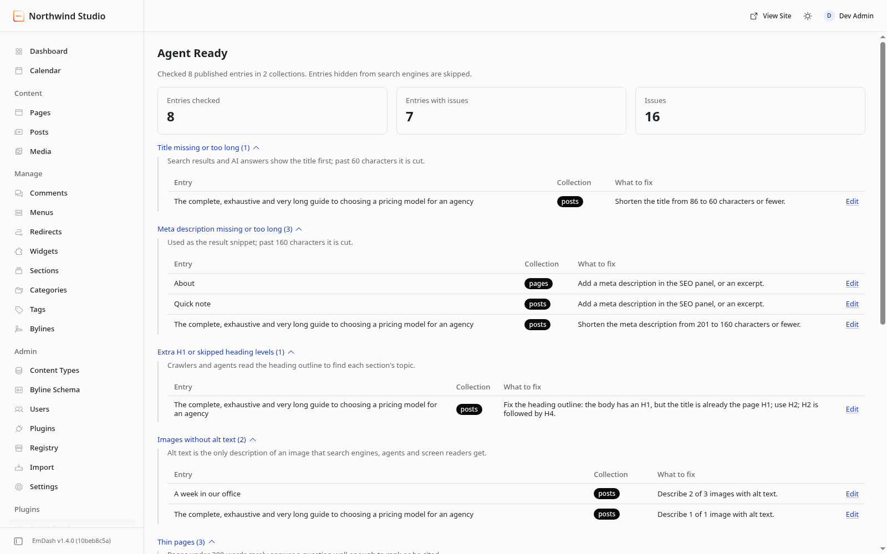

# Agent Ready for EmDash

Find what stops search engines, AI answers and AI agents from understanding your content, and
fix it in the editor.



Agent Ready is a free, open-source plugin for [EmDash CMS](https://emdashcms.com) by
[WorkPods](https://workpods.ai). It adds an **Agent Ready** admin page and a dashboard widget. Both
check every published entry and say what to fix, with a link to the entry's editor.

It reads content only. It writes nothing, stores nothing and makes no network requests.

## The checks

| Check | Reported when | Why |
| --- | --- | --- |
| Title | Empty, or longer than 60 characters | Google cuts titles wider than about 600px |
| Meta description | Empty, or longer than 160 characters | The SEO panel and Google stop near 160 |
| Headings | An H1 in the body, or a skipped level (H2, H4) | The title is already the H1 |
| Image alt text | No alt text, or only the file name | Crawlers and agents get nothing else |
| Thin pages | Under 300 words in the body | Rarely enough to answer a question and be cited |
| Internal links | No link to another page on the site | Links help crawlers find pages and topics |
| Duplicates | Two entries share a title or description | Look-alike pages compete for one result |

The title and description are the ones search engines get: the SEO panel's values, falling back to
the entry title and excerpt, as EmDash's `getSeoMeta()` does. Titles are measured without the
site-name suffix a template may add. Images come from image fields, image blocks and gallery
blocks, and the alt text checked is the one the page renders. A link counts as internal when it
starts with `/` or points at the host in **Settings > General > Site URL**.

Only published entries in routable collections are checked, and entries marked **Hide from search
engines** are skipped. One page load reads up to 800 entries; past that, the page says the scan is
partial.

## Permissions

| Permission | Why |
| --- | --- |
| `content:read` | To read published entries and their SEO panel values |
| `schema:read` | To find routable collections and the fields that hold titles, bodies and images |

No network access, no storage and no writes. The checks run inside EmDash's plugin sandbox when
the admin page or the widget loads.

To check rendered pages, `llms.txt` and `robots.txt`, use the free
[Agent Ready Chrome extension](https://workpods.ai/tools/agent-ready).

## Install

See [Installation](docs/installation.md) and the [FAQ](docs/faq.md).

## Develop

Node 22.16 or later.

```sh
npm install
npm run typecheck
npm test          # validates the manifest, then runs the tests
npm run bundle    # builds dist/agent-ready-<version>.tar.gz
```

```text
src/checks.ts          The checks, as pure functions over a Page.
src/portable-text.ts   Reads text, headings, links and images from Portable Text.
src/load.ts            Reads entries through EmDash and turns them into Pages.
src/report.ts          Renders the admin page and the widget as Block Kit.
src/plugin.ts          The admin route EmDash calls for the page and the widget.
```

`tests/checks.test.ts` covers each check with fixture pages and runs in seconds.
`tests/admin.test.ts` boots EmDash with the plugin in its sandbox and loads the page and the
widget; the boot takes a minute or two.

To try it on a local site, run `npm run dev` here and `npm install file:../emdash-agent-ready` in
the site. Then, in the site's `astro.config.mjs`, `import agentReady from "agent-ready"` and pass
`sandboxed: [agentReady]` and a `sandboxRunner` to `emdash()`.

Bump `version` in `package.json` for each release, and the major version when `capabilities`
changes, because installed sites agreed to the old list.

## Publishing (owner)

1. Create the public repository `WorkPodsAgents/emdash-agent-ready` and push this one to it.
2. Create a Bluesky account (`yours@workpods.ai`) and set its handle to `workpods.ai`. Bluesky
   shows a DNS TXT record to add: `_atproto.workpods.ai` with the value `did=did:plc:...`.
3. In this directory, run `npx emdash-plugin login workpods.ai` and approve in the browser.
4. Replace the placeholder `"publisher": "did:plc:REPLACE-ME"` in `emdash-plugin.jsonc` with the
   account's DID (`npx emdash-plugin whoami` prints it). Add an `email` to `security` if you want
   one next to the URL.
5. Run `npm test`, then `npx emdash-plugin publish`.
6. Watch the listing checks with
   `npx emdash-plugin info workpods.ai agent-ready --version 0.1.0 --watch` until the plugin is
   live at `https://plugins.emdashcms.com/plugins/@workpods.ai/agent-ready`.

## Licence

Apache-2.0, copyright WorkPods. The WorkPods name and logo are trademarks and are not covered by
the licence; see [NOTICE](NOTICE).
